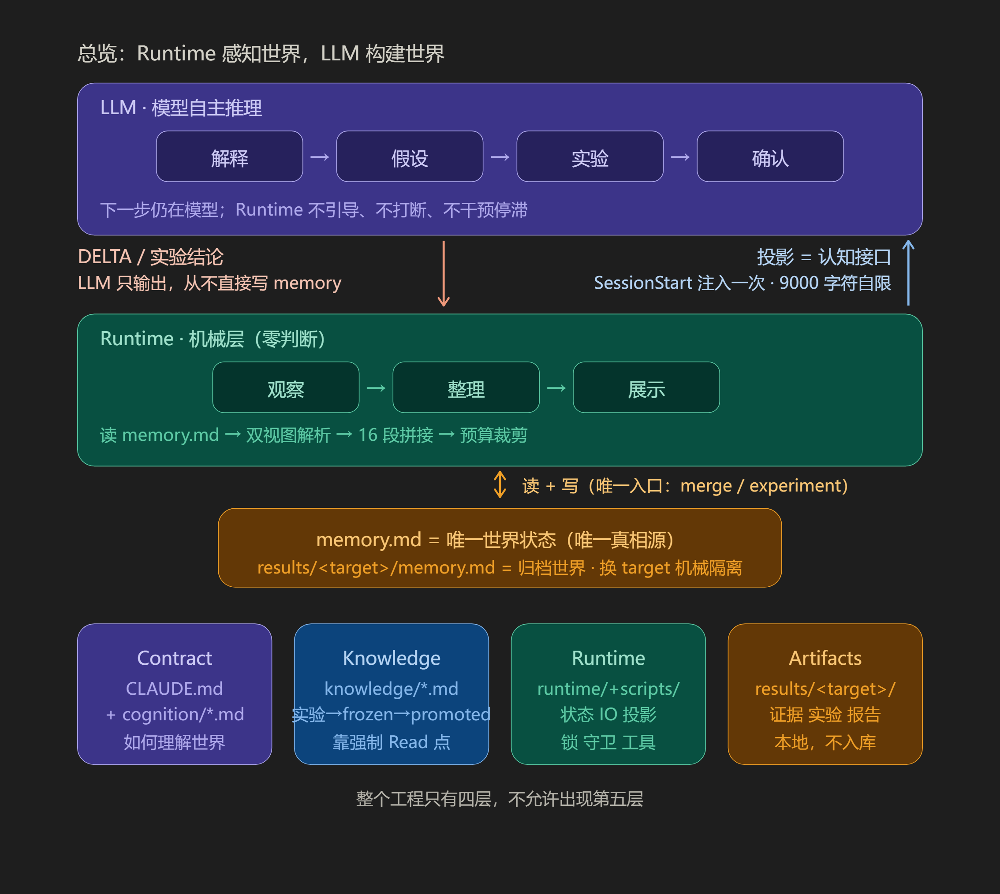
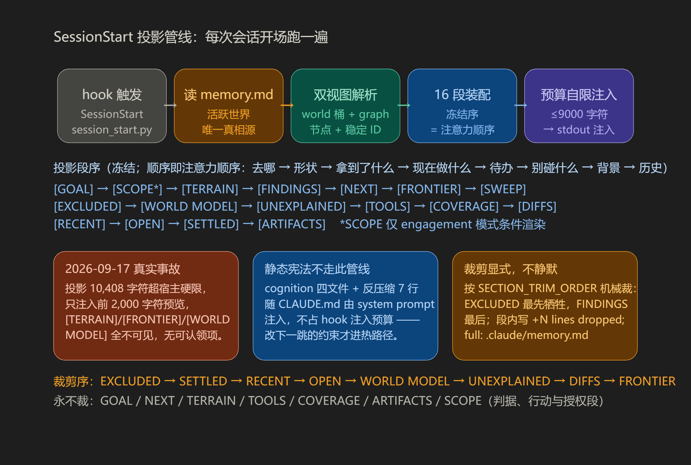
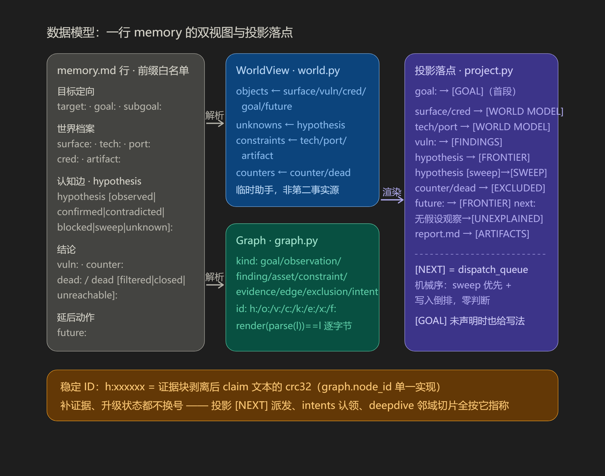
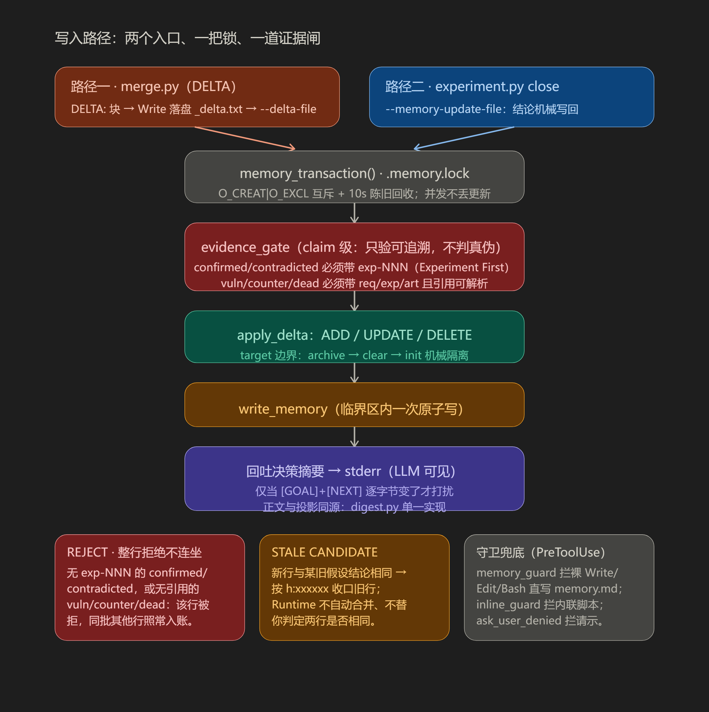
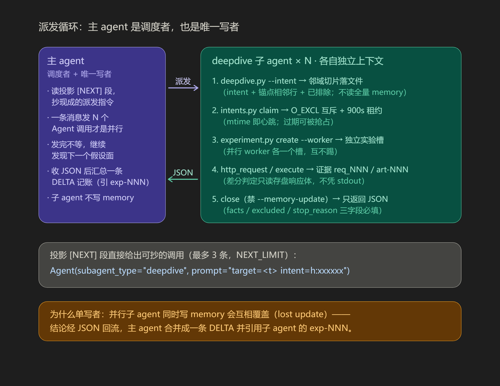

# 象雄（Xiangxiong）

黑盒渗透测试用的 **认知 Runtime**，跑在 [Claude Code](https://claude.ai/code) 上。

不是扫描器，也不是「漏洞菜 + 自动点菜」的专家系统。  
**象雄是研究型框架。** 合法授权与测试范围由使用者自行负责。

> 模型往往有搜索与推理能力；失败常来自 **过早压缩世界**——  
> 相似名并成同一对象、未证关系当成已证、局部成功当成目标完成。  
> Runtime 的职责是 **持久化 LLM 的认知资产**（结论 + 状态 + 证据编号），  
> **不**替模型决定下一步、不判洞、不跑 SOP、不记录事件日志。

仅限授权目标。产物与账本在本地 `results/<target>/`（**不入库**）。

---

## 快速开始

### 前置条件

- **Python 3.8+**（Runtime 只用标准库，无第三方依赖）
- **[Claude Code CLI](https://claude.ai/code)**（宿主执行环境）

### 1. 安装

```bash
git clone https://github.com/AAAAAln1/XiangXiong.git
cd XiangXiong
# 可选：安装测试依赖
pip install -r requirements.txt
```

### 2. 配置 hooks（一次性）

```bash
# 复制 hooks 模板为本地配置（settings.local.json 不入库）
cp .claude/settings.example.json .claude/settings.local.json
# Windows PowerShell：
# Copy-Item .claude\settings.example.json .claude\settings.local.json
```

### 3. 验证安装

```bash
# 跑回归测试（586 个用例 + 46 个子用例，覆盖解析/投影/记账/证据绑定/认领/图往返）
python -m pytest tests/ -q
```

### 4. 第一次使用

```bash
# 在项目根目录启动 Claude Code
claude
# 输入一个授权目标，例如：
#   测试 https://example.com/ 这个站点
```

Agent 启动时 hooks 注入结论账本投影（`[TERRAIN]` / `[FRONTIER]` / `[EXCLUDED]` / `[WORLD MODEL]` / `[UNEXPLAINED]` 等，顺序即注意力顺序：先形状 → 该做什么 → 别做什么 → 定局质量），探索中通过 `merge.py` 合并记账，下次会话开始投影最新账本。产物落在 `results/<target>/`。

> **注意：** 测试前确认目标已获授权；`results/`、`.claude/memory.md`、`settings.local.json` 均不入库。

---

## 设计哲学

多数 Agent 框架在编码 **工作流**。  
象雄探索的是另一条路：在不确定环境里 **不让 LLM 思考过的结论丢失**。

| 原则 | 含义 |
|------|------|
| **认知持久化** | Runtime 保证 LLM 的结论 / 状态 / 证据编号不丢失；对象关系判断保留在模型上下文 |
| **实验优先** | 可差分实验是一等产物；`close` 自动把结论写回账本 |
| **最小 Runtime** | 只做执行、落盘、记账、单次投影——不判洞、不选下一步、不记事件日志 |
| **模型自主推理** | 下一步仍在模型；Runtime 不引导、不打断、不干预停滞 |

对照普通 Agent：

```text
任务 → 工作流 → 工具 → 结果
```

象雄更接近：

```text
观察 → 世界模型 → 假设 → 实验 → 更新后的理解
```

再压成四句：

- Runtime 提供 **能力**，不提供 **决策**
- 知识描述 **世界**，不描述 **流程**
- 实验是 **一等产物**
- **推理责任** 仍在大模型
- 账本存 **结论**，不存 **日志**

**更像成功：** 少把可能性提前删掉、未知边能留住、实验能对准冲突、结论能跨会话恢复。  
**不是 KPI：** 知识文件读了几次、payload 数量、「路径扫了多少」。

---

## 它解决什么 / 不解决什么

| 要解决 | 不解决 |
|--------|--------|
| 上下文里「当前世界」是什么（对象、未知、反证、实验） | 替你规划整条渗透路径 |
| 工具与状态的机械硬度（HTTP / 实验 / memory 闸） | 自动选漏洞类型 / 技能路由 |
| 减少错误完成信号（有报告 ≠ 测完） | 保证一定挖到洞 |
| 长会话 / 中断后认知可恢复（结论账本 + 证据引用可解析） | 把经验库塞进每轮上下文 |

---

## 四层架构

整个工程只承认四层。不允许靠「再加 Mode / Planner / 知识路由器」变成第五层。

```text
契约 Contract     ← CLAUDE.md + cognition/*.md
知识 Knowledge    ← knowledge/*.md
运行时 Runtime    ← runtime/ + scripts/（执行 / 记账 / 会话开始投影）
产物 Artifacts    ← results/
```



读图要点：LLM 只输出（DELTA / 实验结论），从不直接写 memory；Runtime 零判断（观察 → 整理 → 展示）；`memory.md` 是唯一世界状态，唯一写入口是 `merge.py` / `experiment.py`；投影是认知接口（SessionStart 注入一次，9000 字符自限）。**整个工程只有四层，不允许出现第五层。**

### 契约（Contract）

- **`CLAUDE.md`**：给渗透 Agent 的短合同——工具怎么敲、账怎么记、完成边界、报告槽位。要短、可执行。
- **`cognition/*.md`**：推理镜头（对象 / 证据 / 实验 / 表面错位），**不是**领域操作手册。  
  由 `CLAUDE.md` 末尾的 `@cognition/*.md` 强制导入，随 system prompt 注入；Runtime 不按目标选型或解释内容。

人 / 维护者读的边界说明在 **`ARCHITECTURE.md`**，不要和 Agent 热路径混读。

### 知识（Knowledge）

先验有生命周期：

```text
实验假设 → 冻结标本 →（跨目标重复 miss + 可观察行为改善）→ 可进入运行时的先验
```

**未证明能改变「世界模型更新行为」的文本，没有资格当运行时知识。**

| 文件 | 状态 | 含义 |
|------|------|------|
| `bounty_criteria.md` | 报告过滤 | 写 `report.md` 前**必须**阅读；冷，不进会话开始 |
| `report_spec.md` | 报告格式 | 同一次阅读的第二件事（一洞一节 / 每步附可回放的原始请求包 / 证据绑定 / 收口自检清单）；冷，不进会话开始 |

热路径里与「压缩纪律」相关的，是会话开始固定 **7 行** 反压缩短句（硬编码在 `runtime/project.py`），**不是**把 `knowledge/` 整目录热起来。

`false_closures.md` 与 `*_objects.md` 已删：前者价值已兑现进那 7 行（正文跨全部会话 0 读取），后者跨全部会话仅 1 次读取，且两者零代码引用、无强制 Read 点（见 `ARCHITECTURE.md`）。

### 运行时（Runtime）

| 目录 | 职责 |
|------|------|
| `runtime/` | HTTP、执行、实验、合并 memory |
| `scripts/` | 会话开始投影 / memory 守卫等 hook |

原则：

- 只做 IO、状态、单次投影与记账；
- **不**判断漏洞、**不**选下一步、**不**按关键词加载知识、**不**记录事件日志；
- 保证「LLM 判定过的结论被保存、引用可恢复、目标一致」，不干预 LLM 的探索过程。

### 产物（Artifacts）

`results/<target>/` 保存本场可复查材料（**仅本地，默认不进 Git**）：

| 路径 | 内容 |
|------|------|
| `responses/` | HTTP 全文（界面截断 ≠ 全文，以磁盘为准） |
| `experiments/exp-NNN/` | 实验假设、观察、结论 |
| `scripts/` | 本场脚本与 PoC |
| `report.md` | 给人 / 平台看的漏洞报告 |
| `lessons.md` | 短复盘 + 主因 |
| `memory.md` | 本目标归档世界（换目标时由 merge 机械归档） |

**当前热世界** 在 `.claude/memory.md`（唯一 active）。  
`merge.py` 在 DELTA 出现新 `target:` 时：**归档 → 清空 → 初始化**，不判断公司 / 根域是否该继承。

---

## 目录结构

```text
xiangxiong/
├── CLAUDE.md                 # Agent 合同（热路径；cognition 经 @include 随 system prompt 注入）
├── README.md                 # 本文件（人）
├── ARCHITECTURE.md           # 开发者边界（人）
├── LICENSE                   # MIT
├── .claude/
│   ├── settings.example.json #   hooks 模板（settings.local.json / memory.md 不入库）
│   └── agents/deepdive.md    #   deepdive 子 agent 定义（隔离上下文，只返回 JSON）
├── cognition/                # 推理镜头（CLAUDE.md 末尾 @ 强制加载）
│   ├── object_model.md       #   对象图：同一失败机制 = 同一对象
│   ├── evidence_model.md     #   结论必须可追溯
│   ├── experiment_model.md   #   可差分实验是一等产物
│   └── surface_misalignment.md
├── knowledge/                # 冷知识（收口时强制 Read，不进热路径）
│   ├── bounty_criteria.md    #   报告过滤（进/不进 report）
│   ├── report_spec.md        #   报告格式 + 收口自检清单
│   └── intranet_tools.md     #   内网工具参数合同（首次使用前读）
├── runtime/                  # 工具与状态机（22 模块，纯标准库 ~8.1k 行）
│   ├── http_request.py       #   HTTP 主路径：--sweep/--batch/--cred/--session；证据强制落盘
│   ├── execute.py            #   非 HTTP 受控执行：--background / exec-NNN / --bg-wait
│   ├── experiment.py         #   实验槽：create --activate --worker；close 机械写回账本
│   ├── merge.py              #   唯一写入口：DELTA 事务 + 证据闸 + 凭据闸 + 稳定 ID 收口
│   ├── graph.py              #   类型化节点图：稳定 ID / 锚点 / 邻域 / 逐字节无损往返
│   ├── world.py              #   行 → WorldView 桶（与 graph 同一输入的两个视图）
│   ├── project.py            #   SessionStart 投影：16 段装配 + 9000 字符自限
│   ├── digest.py             #   决策摘要 [GOAL]+[NEXT]（投影与记账回吐共用单一实现）
│   ├── deepdive.py           #   邻域切片器（派发前机械准备；派发归宿主 Agent 工具）
│   ├── intents.py            #   前沿认领：O_CREAT|O_EXCL 原子 claim + 900s 租约
│   ├── evidence.py           #   请求台账：inventory / list / show / grep（只读）
│   ├── diff_scan.py          #   机械差分候选 → [DIFFS]
│   ├── protocol_scan.py      #   协议元素聚合（端点/表单/Cookie/指纹）
│   ├── toolcheck.py          #   [TOOLS] 工具面检查
│   ├── turn_state.py         #   轮次状态（无工具用轮次 + 证据引用）
│   ├── scope.py              #   双层授权闸（engagement 模式，越界动作前 REJECT）
│   ├── credentials.py        #   引用式凭据库（值不进账本/投影）
│   ├── intranet_scan.py      #   nmap 聚合 → [HOST MAP] + 可抄 surface 行
│   ├── hook_patterns.py      #   guard 共用正则（单一实现）
│   ├── filelock.py           #   跨进程锁（请求号 / 实验号 / memory 事务）
│   └── paths.py / state.py   #   world 绑定 / runtime.json
├── scripts/                  # hooks + 验证工具
│   ├── session_start.py      #   SessionStart 单次投影入口
│   ├── memory_guard.py       #   PreToolUse：禁裸写热 memory
│   ├── inline_guard.py       #   PreToolUse：栏内联脚本
│   ├── ask_user_denied.py    #   PreToolUse：AskUserQuestion 一律 deny + 替代动作
│   ├── batch_server.py       #   批量多目标跑批（HTTP 服务）
│   ├── validate_persistence.py #  离线认知持久化验证
│   ├── probe_headless.py     #   headless 探针
│   └── metrics/llm_labor.py  #   LLM 机械劳动度量
├── resources/wordlists/      # 中性词表（surface 先验，非扫描器大脑）
├── assets/                   # 架构图（本 README 使用）
└── results/                  # 按目标的产物（本地，不入库）
```

---

## 上下文如何加载（Agent 看见什么）



管线五步：hook 触发 → 读 `memory.md`（唯一真相源）→ 双视图解析（world 桶 + graph 节点/稳定 ID）→ 16 段装配（冻结序 = 注意力顺序）→ 预算自限注入（≤9000 字符 → stdout）。

### 1. Claude Code 读 `CLAUDE.md`

操作合同：HTTP / 执行 / 实验 / memory 前缀、探索与收口、有漏洞时如何写 `report.md`。

### 2. 会话开始（`scripts/session_start.py`）

每个会话开始时注入（顺序以脚本为准）：**只注入动态世界状态**。

| 段 | 作用 |
|----|------|
| `[GOAL]` | 搜索的终止条件与阶段里程碑（`goal:` / `subgoal:`）。**首段**——其余每段回答"怎么走"，只有它回答"去哪"；未声明时会给出可抄的写法 |
| `[TERRAIN]` | 形状计数（各 kind 数量 / edge 各状态）。**首段判据**，先看形状再看细节 |
| `[FINDINGS]` | 交付物（`vuln:`）。与 `[GOAL]` 构成唯一一对读数量：要什么 / 拿到了什么 |
| `[NEXT]` | **此刻可做的事**，每条一行、可直接复制。排序照抄 Cairn 的 dispatcher（最新未认领优先），排除 `[blocked]` 与已闭合项；无可派项时说明原因并指向扩未知的方向 |
| `[FRONTIER]` | 未闭合假设 + `future:` 声明的下一步，每条带稳定 ID（`h:`/`f:`）供派发/认领；**段头带一条可复制的 `Agent(subagent_type="deepdive", …)`** |
| `[SWEEP]` | 批量机械验证类工作（`hypothesis [sweep]:`：枚举/爆破/限流/逐条比对）。**待派队列**，默认派子 agent |
| `[EXCLUDED]` | 排除集（counter / dead）。最省时间的一类信息 |
| `[WORLD MODEL]` | 结论账本（surface / cred / vuln + tech / port / artifact/tech 约束） |
| `[UNEXPLAINED]` | 锚点未被任何假设提及的观察（上限 10 条） |
| `[COVERAGE]` | 请求数 / 去重路径 / 只探过一次的路径（广度缺口） |
| `[DIFFS]` | 机械差分候选（状态码差异 / 体长差异） |
| `[RECENT EXPERIMENTS]` / `[OPEN EXPERIMENTS]` | 当前 target 的实验状态 |
| `[SETTLED]` | 已闭合假设（confirmed / contradicted） |
| `[ARTIFACTS]` | `report.md` / `lessons.md` 的存在性（present/absent）。**元数据，不是完成判据** —— 停不停是 Agent 的事 |

静态宪法（`[COGNITION]` 四个认知模型 + `[ANTI-COMPRESSION]` 七行）**已移出 hook**，
改由 `CLAUDE.md` 末尾的 `@cognition/*.md` 导入，随 system prompt 注入——原因见下。

#### 投影预算：为什么投影必须自限

宿主对 SessionStart hook 的 `additionalContext` 有**硬上限**（claude-code 2.1.x
为 10,000 字符）：超出就不再注入原文，只注入**前 2,000 字符预览**。

2026-09-17 首次真实执行即踩中：投影 10,408 字符 → 预览里全是排在最前的
`[COGNITION]` → agent 开局看不到 `[TERRAIN]`/`[FRONTIER]`/`[EXCLUDED]`/`[WORLD MODEL]`
→ 没有可认领项 → 认领 / 实验 / 深挖全部归零。

对策两条，缺一不可：

1. **静态与动态分流**：会话不变量进 `CLAUDE.md`；hook 只装动态世界状态。

   > **`CLAUDE.md` 没有"上限"这种东西。** 宿主 `src/utils/claudemd.ts` 的
   > `MAX_MEMORY_CHARACTER_COUNT = 40000`，注释写明是 **"Recommended"**；它只被
   > `/doctor` 的 context warning（`severity: 'warning'`）和状态栏提示引用，
   > **不截断、不替换**——超了照样全文注入，只是弹一句"will impact performance"。
   > 真正会静默丢内容的只有 `@include` 的几条规则：最大嵌套深度 `MAX_INCLUDE_DEPTH = 5`、
   > 非文本扩展名跳过、项目外 include 未批准则跳过、`claudeMdExcludes` 可整份排除。
   > （另有 AutoMem 的 `MEMORY.md` 入口会被硬截到 200 行 / 25,000 字节，**不适用于 `CLAUDE.md`**。）
2. **投影自限 `PROJECTION_BUDGET_CHARS = 9000`**：超限按 `SECTION_TRIM_ORDER` 机械裁剪，
   并**显式写出**丢了几行、全文在哪（`… +N lines dropped by projection budget; full: …`）。
   裁剪顺序保证 `[TERRAIN]`/`[FRONTIER]`/`[EXCLUDED]` 最后才动——静默丢失比截断更糟。

### 3. 其它 hooks

| 时机 | 脚本 | 作用 |
|------|------|------|
| 写文件前 | `memory_guard.py` | 禁止直接改热 memory |

v0.3 起**没有** PostToolUse / Stop hook：工具调用后不重投影、不记录停滞、不干预轮次。世界更新完全由「合并记账 → 下次 SessionStart 投影」驱动。

### 4. `knowledge/` 默认不加载

只有主动阅读才会看到正文。现存两个文件，都在**收口时**由 CLAUDE.md 强制阅读：
`bounty_criteria.md`（进/不进 report 的过滤）与 `report_spec.md`（report 的格式与收口自检）。
它们原先合并挤在 `CLAUDE.md` 里每轮都在场，实测占静态负载 6.4% 却只在写报告那一刻有用
（长期取舍见 `ARCHITECTURE.md`）。

---

## 两个重要设计点

### A. 产物完成 ≠ 探索完成

历史上：有了 `report.md` 就关掉恢复投影，等于用 **产物** 冒充 **世界已测完**。

现规则：

- 是否投影恢复上下文，**只看**「有目标 + memory 账本非空」；
- 报告 / 复盘 **只**出现在产物元数据里，**不**参与「是否恢复」判断。

```text
完成证据 ≠ 探索完成
对象边闭合 ≠ 整个目标世界闭合
写完报告 = 导出产物，不是目标已测完
```

### B. 压缩纪律是「曝光」，不是「触发器」

`[ANTI-COMPRESSION]` 七行（`CLAUDE.md` 末尾的固定短句，原则不是步骤；2026-09-17 随静态宪法一并移出 hook 注入）：

```text
Similar identifier ≠ same object.
Related behavior ≠ proven shared boundary.
Successful path ≠ adjacent surface exhausted.
Missing observation ≠ absence.
Blocked surface ≠ excluded surface.
Supported explanations should constrain the next experiment.
Preserved unknowns do not retain equal priority outside the current explanation boundary.
```

中文对照：

1. 相似标识 ≠ 同一对象  
2. 相关行为 ≠ 已证明的共同边界  
3. 某条路径成功 ≠ 邻接面已穷尽  
4. 缺观察 ≠ 不存在  
5. 被阻塞的面 ≠ 已被排除的面  
6. 已获支持的解释，应约束下一跳实验  
7. 解释边界外的未知可以保留，但不应与当前主线等权抢预算  

| 是 | 不是 |
|----|------|
| 建对象图时的默认摩擦 + 支持后的下一跳约束 | 漏洞技巧库 / 规划器 |
| 低干扰、不必「被调用很多次」 | 每轮强制检查清单 |
| 防错误压扁，也防支持后无关未知等权 | 发现漏洞后加载失败先验全文 |

验证应看：**高支持解释之后，下一跳是否偏向确认 / 细化 / 证伪该解释**。  
**不要**用知识文件读取次数当成功指标。

---

## Memory 与记账

Memory 回答 **「当前目标已确认的认知资产」**——结论账本，不是操作日志、不是环境截图。



一行 memory 同时被两个视图解析：`world.py` 给桶（objects / unknowns / constraints / counters），`graph.py` 给类型化节点（kind + 稳定 ID + 锚点），投影决定每行落到哪个段。**稳定 ID = 归一化 claim 文本的 crc32（`graph.node_id` 单一实现）**——补证据、升级状态都不换号，投影 `[NEXT]` 派发、`intents` 认领、deepdive 邻域切片全按它指称。

| 前缀 | 含义 |
|------|------|
| `surface:` / `vuln:` / `cred:` | 对象事实 / 已确认漏洞 / 凭据 |
| `tech:` / `port:` / `artifact:` | 技术约束 / 端口 / 证据索引 |
| `hypothesis:`（可选 `[observed\|confirmed\|contradicted\|blocked]`） | 关系 / 未知（带状态） |
| `counter:` / `dead:` | 反证 / 死路 |
| `target:` | 身份 |
| `future:` | 延后动作（非问题）；投影为 `[FRONTIER]` 段的 `next:` |

- 禁止直接改热 memory；走 `echo "DELTA:…" | python runtime/merge.py`。
- 每条少于 3 行，一次不超过 15 行；有观察 / 冲突 / 结论才写，不是每步填表。
- 换目标：DELTA 写新 `target:` → merge 机械归档旧世界。

**结论 vs 事实**：`surface:` 只记对象存在性 / 技术事实。越权 / 绕过 / 泄露等探索**结论**用 `hypothesis [状态]` / `vuln:` / `counter:` 表达，并带 `req_`/`exp-` 证据编号——结论不带证据或引用不可解析时，merge 会打 WARN / WARN HIGH。

**账本是更新不是追加**：同一 target 内，同文本的 `hypothesis` 行会被**替换**（状态升级，如 `observed` → `confirmed` 带证据），不会重复堆积；不同文本则是新条目。



写路径五步：两个入口（`merge.py` DELTA / `experiment.py close` 机械写回）→ `memory_transaction()` 跨进程锁（O_CREAT|O_EXCL 互斥 + 陈旧锁回收，并发不丢更新）→ `evidence_gate`（只验可追溯不判真假：`confirmed`/`contradicted` 必须带 `exp-NNN`；`vuln`/`counter`/`dead` 引用必须可解析）→ 临界区内一次原子写 → 决策摘要回吐 stderr（仅当 `[GOAL]+[NEXT]` 逐字节变了才打扰）。REJECT 是整行拒绝不连坐——同批其他行照常入账。

错误示例：`surface: 测试了 /admin`  
正确示例：`hypothesis [confirmed]: 未授权可读他人问卷 (req_747)`

---

## 常用 Runtime 工具

细节以 `CLAUDE.md` 为准。

| 能力 | 入口 |
|------|------|
| HTTP | `python runtime/http_request.py <target> <curl 风格参数…>`（禁止裸 curl 当主路径） |
| 非 HTTP / 脚本 | `python runtime/execute.py <target> --timeout 60 --purpose "…" --cmd "…"`；复杂逻辑先写 `results/<target>/scripts/` |
| 实验 | `create … --activate --hypothesis "…"`；`close … --status success\|failed\|blocked\|unknown --memory-update-file results/<target>/scripts/_exp_close.json`（JSON 先落盘再传路径，躲开 shell 引号；close 自动写回账本） |
| Memory | DELTA 先 Write 落盘，再 `python runtime/merge.py --delta-file results/<target>/scripts/_delta.txt`（零转义） |

**不要用 `echo "DELTA:\n…" \| merge.py`**：shell 的 `echo` 不解释 `\n`，整段挤成一行 → **静默记 0 条**（无报错、`exit 0`）。见 `tests/test_cli_ergonomics.py`。

展示截断 ≠ 磁盘全文：以 `results/<target>/responses/` 为准。

---

## 并行探索：主 agent 是调度者，也是唯一写者



- **何时派发**：同一种探测要重复 N 次（枚举 N 个端点/参数/ID、N 变体 fuzz、限流/爆破、逐条契约核对），或单条线的原始输出会淹没主上下文 → 默认派 `deepdive` 子 agent。`[FRONTIER]` / `[SWEEP]` 段头直接给出可复制的调用（`[NEXT]` 段最多 3 条），动作降到「抄一行」。
- **一条消息发 N 个 `Agent` 调用才是并行**；发完不等，继续发现下一个假设面。
- 子 agent 一轮：`deepdive.py --intent h:xxxxxx` 拿邻域切片（意图 + 共享锚点行 + 已排除方向，**不读全量 memory**）→ `intents.py claim` 原子认领（O_EXCL + 900s 租约，过期可被抢占）→ `experiment.py create --worker` 开独立实验槽（并行 worker 各一槽，互不踢）→ 差分证据落盘（`req_NNN`/`art-NNN`）→ close（禁 `--memory-update`）→ 只返回 JSON（facts / tested_paths / excluded / stop_reason 必填）。
- **memory 只有主 agent 写**：收到 JSON 后汇总成一条 DELTA 记账并引用子 agent 的 `exp-NNN`。并行子 agent 同写 memory 会互相覆盖（lost update）——结论经 JSON 回流、单写者合并，是刻意设计。

---

## 报告（`report.md`）

给人 / SRC 平台看，**一洞一节**。

- 标题、域名、类型、等级  
- 简述（概况 + 危害；URL / Payload 不进简述）  
- **完整绝对 URL** + 可选功能导航  
- 分步复现 + **每个 HTTP 步附完整原始请求包**（`METHOD /path HTTP/1.1`+`Host`+Header+空行+Body，可粘 Burp Repeater）/ 响应 + `req_xxx` / 实验编号  
- 可落地修复  

写报告前**必读** `knowledge/report_spec.md`（格式）与 `knowledge/bounty_criteria.md`（过滤）。
本节只是摘要，**细则以那两份为准**（含"收口自检"清单）。  
纯配置 / 指纹 / 无利用链信息泄露 → 可不写报告（memory 已记录）。  
多洞可同文件；禁止只有摘要表或无证据「可能」。

---

## 使用

安装、hooks 配置与验证见顶部 **[快速开始](#快速开始)**。

```bash
cd xiangxiong
claude
```

hooks 由 Claude Code 读取 `.claude/settings.local.json`，模板里是相对路径的 `scripts/` 入口（`settings.example.json`）。

**范围：** 仅授权目标。作者不对未授权扫描或滥用负责。  
**不要提交：** `results/`、`.claude/memory.md`、本机 `settings.local.json`、cookie / VPN / `.env`（见 `.gitignore`）。

---

## 更新日志

### v0.4.0（2026-10）

**前沿显式化 + 类型化图 + 并行派发 + 内网工具族**

认知层语义（解析 / 记账 / 证据闸）零破坏升级；全量回归 **586 passed + 46 subtests**。五张架构图见上文各节（总览 / 投影管线 / 数据模型 / 写入路径 / 派发循环）。

#### 前沿与派发
- **[FRONTIER]/[SETTLED] 拆分**：hypothesis 按状态分段展示，行带稳定 ID（`h:xxxxxx` = 归一化 claim 文本的 crc32，`graph.node_id` 单一实现）；补证据或升级状态不改号。`[NEXT]` 段直接给出可复制的 `Agent(subagent_type="deepdive", …)` 派发指令（≤3 条），派发动作降到「抄一行」。
- **前沿认领协议**：`intents.py` —— O_CREAT|O_EXCL 原子认领 + 900s 租约（heartbeat 续约 / 过期可抢占）；并发子 agent 抢同一假设不再重复探索。
- **类型化节点图**：`graph.py` —— 9 类语义 kind（goal/observation/finding/asset/constraint/evidence/edge/exclusion/intent），`render(parse(x)) == x` 逐字节无损往返；`[TERRAIN]` 形状计数与 `[UNEXPLAINED]`（锚点未被任何假设提及的观察）都从图上机械算出。
- **邻域切片**：`deepdive.py --intent h:xxxxxx` —— 派发前把「意图 + 共享锚点行 + 已排除方向」裁成独立上下文；探索者不读全量 memory。
- **聚合投影**：judge 侧按端点/对象聚合 + 注意力顺序重排；投影自限 9000 字符，超限按 `SECTION_TRIM_ORDER` 机械裁剪并显式报数（防宿主 hook 硬上限的静默截断）。

#### 内网与证据工具族
- `scope.py`：双层授权闸（`scope.json` 声明 + 命令字面量复核），私网目标无授权 → 动作前 REJECT；engagement 模式投影 `[SCOPE]`（授权 / 立足点 / 凭据数 + 授权容量 vs 存活主机）。
- `credentials.py` + merge 凭据闸：凭据值只落 `results/<t>/credentials/c-NNN.txt`，账本只许写引用；明文口令 / 32/64hex / JWT / PEM 形态一律 REJECT。
- `intranet_scan.py`：nmap XML/grepable → `[HOST MAP]` + 可抄 `surface:` 行；`protocol_scan.py`：端点/表单/Cookie/指纹机械聚合；`evidence.py`：请求台账 `inventory/list/show/grep`；`dead [filtered|closed|unreachable]:` 三态入账。

#### 写入与守卫
- 写入双入口（`merge.py --delta-file` / `experiment.py close --memory-update-file`）→ `memory_transaction()` 跨进程锁 → `evidence_gate` → 临界区内原子写 → 决策摘要回吐（仅 `[GOAL]+[NEXT]` 逐字节变化才打印）。
- guards 三件套：`memory_guard`（禁裸写热 memory）/ `inline_guard`（栏内联脚本）/ `ask_user_denied`（AskUserQuestion 一律 deny + 给替代动作）；STALE CANDIDATE 收口提示 + `[REMOVE]/[UPDATE]` 按稳定 ID 定位。
- 并行友好：`--worker` 独立实验槽；请求号 / 实验号 / memory 事务均有文件锁，并发不撞号、不丢更新。
- **干净克隆**：`tests/conftest.py` 自动播种最小本地状态；phase0 金样与全部回归在 fresh clone 上直接全绿。

### v0.3.1（2026-08）

**证据完整性加固 + Runtime 边界冻结**

#### 三刀清理（冻结前收尾）
- **删除 pattern_counts**：`http_request.py` 移除 v0.2 Observer 残留的响应签名统计（`.pattern_counts.json` / `[OBSERVATION REPETITION]`）。Runtime 不再产生任何事件日志，只剩 `request → save response artifact → metadata → experiment binding`。
- **证据引用完整性（账本 FK 约束）**：`merge.py` 对结论行做三级校验——L1 无证据引用 WARN；L2 引用（`req_NNN`/`exp-NNN`）文件不可解析 WARN HIGH；L3 可解析静默停止。只查存在性，不检查响应内容、不判断是否证明漏洞。
- **hypothesis ledger update semantics**：同 target 内同 normalized text（去状态 / 去证据块 / 压缩空白）的 `hypothesis` 行被**替换**（状态升级），不同文本为新条目——memory 是账本不是日志。

#### Runtime 边界冻结
- **删除 observer 残留**：`merge.py` 移除 `OBSERVE_STATE_PATH` 常量、`reset_observe_on_target_change()` 函数（31 行）、`.observe_state.json` 读写逻辑、`consecutive_none` / `same_action_count` / `prefix_counts` 计数器。
- **[OPEN EXPERIMENTS] 投影**：SessionStart 新增未关闭实验状态展示（id / observations 数量 / artifact / hypothesis），纯状态投影，不提醒关闭、不判断生命周期、不阻塞行为。
- **离线验证工具**：新增 `scripts/validate_persistence.py`，衡量 evidence coverage、hypothesis lifecycle completion、experiment→memory 转化率。
- **架构边界确认**：Runtime 职责收敛为 artifact persistence + cognitive ledger + context projection；不判断停滞、不控制行为、不引入 planner/workflow。

测试收敛：25 tests passed（删除 pattern 回归锁）。

### v0.3.0（2026-08）

**从"行为控制系统"收敛为"认知持久化 Runtime"**

- **删除高频投影**：移除 PostToolUse `assembler.py`（每次工具调用重复注入 3KB Contract）与 Stop `stop_check.py`；hooks 只剩 PreToolUse memory_guard + SessionStart。世界更新由「合并记账 → 下次 SessionStart 投影」驱动。
- **删除停滞传感（v0.3.0）**：`observe.py` / `[OBSERVE]` 段整体移除（对脚本化 HTTP 失明且无接线决策）。v0.3.1 后续清除 `.observe_state.json` Runtime 残留。
- **实验闭环自动写回**：`experiment.py close --memory-update '{"text":...,"evidence":[...]}'` 机械写回 `hypothesis [状态]` + 证据行（target 校验 / 查重 / 写入），消灭"憋大改"手工 DELTA。
- **证据绑定**：merge 对 `confirmed/contradicted/vuln/counter` 无证据引用打 WARN；CLAUDE.md 明确"结论 vs 事实"记账规则。
- **结论账本**：memory 从"对象世界模型"收敛为"已确认认知资产账本"（vuln / hypothesis[状态] / counter / dead + 证据编号）。
- 实测：无投影下 agent 自主完成微前端逆向（某 SRC 目标 A）、签名还原 + AES/DES 解密（某 SRC 目标 B），结论均带证据落账。

### v0.2.0（2026-08）

**Object-Centered projection 一致性修复**

- **投影镜像 world schema**：`hypothesis` 按 memory 顺序展示，state 作为行内属性（`observed/confirmed/contradicted/blocked/unknown`），不按 state 值过滤。v0.4.0 起按 state 拆为 `[FRONTIER]`（未闭合）与 `[SETTLED]`（已闭合）两段——**只是分段显示，不改变任何语义**，每行带稳定 ID（`h:xxxxxx`），补证据或升级状态不改号。
- **移除 schema 外分类**：删除 `OPEN UNKNOWNS` / `STALLED` 自创桶名与过滤逻辑，消除 projection 对世界状态的解释层。
- **Contract 边界句收敛**：引导语只保留"来自世界模型，不是任务要求，不是下一步指令"。
- **回归锁**：新增 state visibility 测试——hypothesis 从 `observed` 转移至 `confirmed/contradicted` 后仍必须可见，防未来再次丢失 state（65 tests passed）。

**Runtime 能力增强（v0.1 → v0.2 累积）**

- **Observation Artifact Contract**：`execute.py` / `http_request.py` 返回 `stdout_*/stderr_*` 与 `body_artifact/body_size/body_truncated` 物理元数据（截断 ≠ 全文）。
- **Turn Event Telemetry**：`stop_check.py` 统计 `turn_tool_use_count` / `turns_without_tool_use`，仅被动传感，不接 `decision:block`。
- **单投影源（Phase 2.0）**：`assembler.py` 收敛为 runtime 适配器，SessionStart 与 PostTool 共享 `format_world_section` / `format_unknown_sections`。
- **测试体系**：`tests/phase0` ~ `tests/phase2_3` 分阶段回归锁，验证解析无损、投影一致、边界契约。
- **上手体验**：README 新增「快速开始」章节；新增 `requirements.txt` 明确依赖（Runtime 纯标准库，测试需 pytest）。

---

## 相关文档（读者分流）

| 读者 | 读什么 |
|------|--------|
| 渗透 Agent | `CLAUDE.md`、会话开始投影、cognition |
| 人 / 维护 | 本 README、`ARCHITECTURE.md` |
| 冷先验正文 | `knowledge/*`（不自动进会话） |
| 单场事实 | `results/<target>/`（本地） |

改热路径（`CLAUDE.md` / cognition / 会话开始投影）时：  
**站在模型角度——删了下一跳会变吗？不变则删。**  
金句、演进史、给人看的叙事进 `ARCHITECTURE` / 本文，不灌进 Agent 合同。

---

## 一句话

**象雄 = 在 Claude Code 上给黑盒渗透一个「认知持久化 + 最小摩擦」的 Runtime；  
不控制 Agent 怎么探索，只保证它想清楚的结论不丢失——  
优化的是过早收缩世界的偏差，不是堆更多漏洞菜单。**

---

## 开发者声明

这是个人对 LLM Agent 认知架构的探索，重点在"如何避免模型过早闭合世界"。

设计取舍（行为优先、对象延迟、反因果表达）基于有限实验，可能存在未发现的问题。欢迎讨论与质疑。
